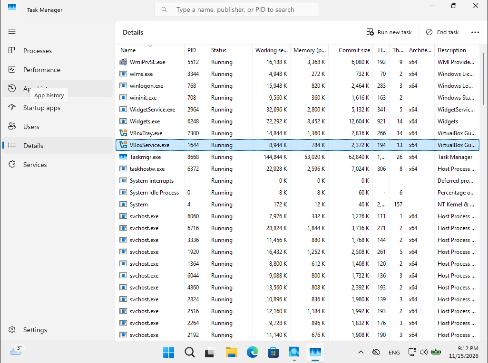
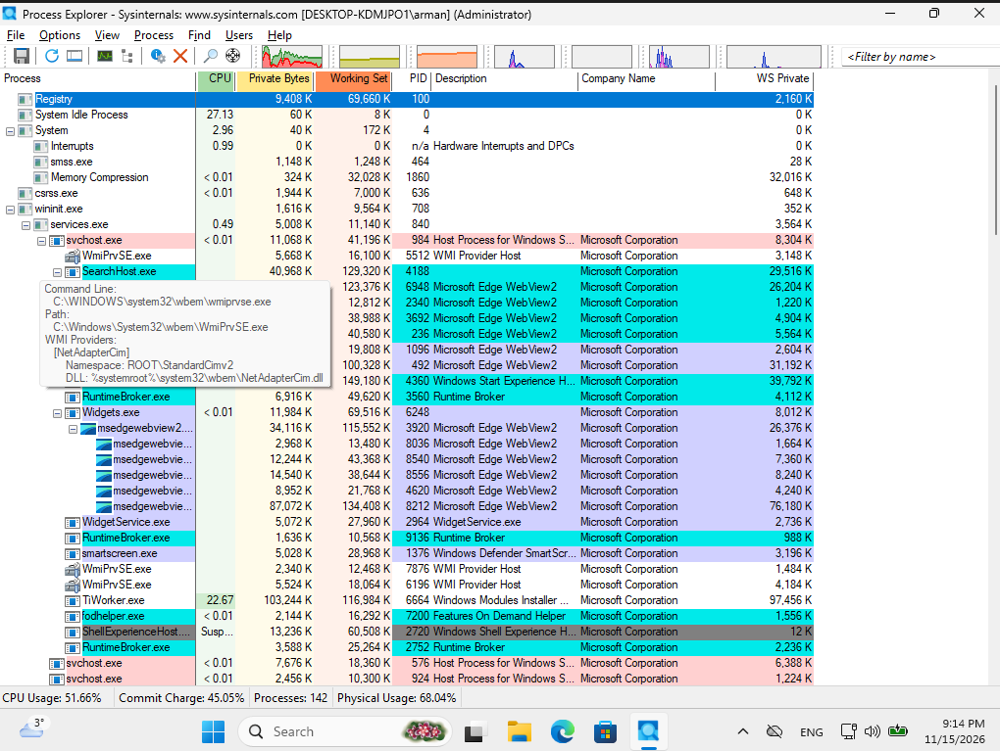
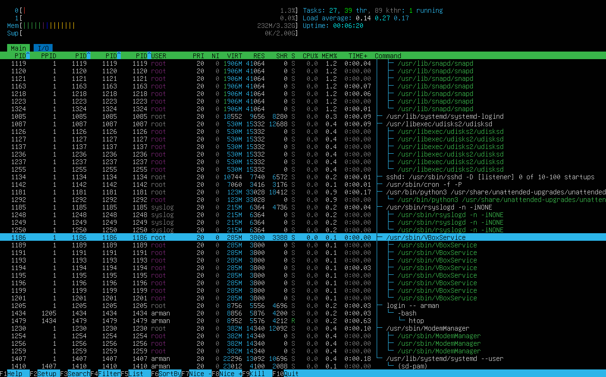

# Lab 6 — Live processes and memory pressure

Name: Arman· Date: 15 November 2026 · Guests: Ubuntu  version (4 GB RAM at first, lowered to 2 GB for Part 2; 2 GiB swap; console only, no GUI) / Windows 11  edition, RAM 4 gb

## Part 1 — One process, three tools

Process chosen: **VBoxService** (`VBoxService.exe` on Windows, `VBoxService` on Ubuntu) — it is the VirtualBox Guest Additions service, it runs on both guests, so the same program can be looked at in Task Manager, Process Explorer and htop.

Process IDs: Windows PID 1644, Linux PID 1186.

| | Task Manager | Process Explorer | htop / ps |
|---|---|---|---|
| PID | 1644 | 1724 | 1186 |
| "Memory" as shown by default | 784 K (Memory, private working set) | 1.060 | 3800 K (RES), MEM% 0.1 |
| Private memory | 2,372 K (Commit size) | 2.372 | — (no column in htop) |
| Working set / RES | 8,944 K (Working set) | 1.060 | 3800 K (RES), of which 3388 K is SHR |
| Handles / file descriptors | 194 handles |  | ls /proc/1186/fd \| wc -l` |

Screenshots:   

### Where the tools disagree

1. **One tool, three different "memory" numbers.** In Task Manager the same process, VBoxService.exe, shows Memory (private working set) = 784 K, Working set = 8,944 K and Commit size = 2,372 K. The working set counts every page of the process that is in RAM right now, including pages of DLLs shared with other processes — about 8 MB more than the private part. The private working set counts only pages that belong to this process alone. Commit size counts private memory that was committed whether or not it is in RAM at the moment, so it is bigger than the private working set. So the default "Memory" column of Task Manager is the smallest of the three and does not mean "how much memory the process uses".

2. **Same thing, different name.** Commit size in Task Manager is the same idea as Private Bytes in Process Explorer (Task Manager 2,372 K, Process Explorer 2.372), and htop has no column for it at all. Working set in Windows corresponds to RES in htop, but the two operating systems and the two builds of VBoxService are different, so the numbers (8,944 K on Windows, 3800 K on Linux) are not expected to match.

3. **htop VIRT is not memory in use.** For the same process htop shows VIRT 285M but RES only 3800 K, roughly 75 times less. VIRT is the whole address space (mapped libraries, thread stacks, reserved regions); RES is what is in RAM. SHR is 3388 K of those 3800 K, so only about 412 K (RES − SHR) is not shared — the same order of magnitude as the 784 K private working set on Windows.

4. **htop shows threads as separate rows.** Under the VBoxService line in the htop tree there are eight more rows (PIDs 1189–1201) with the same memory numbers and the same PPID 1. They are threads of one process, not eight other processes, because htop shows userland threads by default. Task Manager and Process Explorer show one row for the process and put the thread count in the Threads column instead.

5. **Handles are not file descriptors.** Task Manager reports 194 handles, which count many kinds of kernel objects (files, events, registry keys, threads, …). On Linux the number from `/proc/1186/fd` counts only open files, sockets and pipes, so the two numbers cannot be compared directly.

## Part 2 — Memory pressure

Guest RAM: 2 GB (I lowered it from 4 GB in VirtualBox → Settings → System while the guest was off; `free -h` shows 1.6 GiB total) · swap: 2.0 GiB

Steps (all on the Ubuntu guest, after taking the VirtualBox snapshot `before-lab6`):

```
free -h
swapon --show
{ echo "=== BEFORE $(date) ==="; free -h; } > memory-pressure.txt
while true; do echo "=== $(date +%T) ==="; free -h; sleep 3; done | tee -a memory-pressure.txt   # second terminal
stress-ng --vm 2 --vm-bytes 70% --timeout 60s
stress-ng --vm 2 --vm-bytes 90% --timeout 60s
stress-ng --vm 2 --vm-bytes 120% --timeout 90s
{ echo "=== AFTER $(date) ==="; free -h; } >> memory-pressure.txt
```

First series (70%, 90%, 120%), numbers from `evidence/memory-pressure.txt`:

| | Before (15:49:56) | During (worst) | After (16:04:32) |
|---|---|---|---|
| Available | 1.2 GiB | 6.5 MiB (16:01:33) | 1.3 GiB |
| Used | 375 MiB | 1.6 GiB (16:00:41) | 280 MiB |
| Swap used | 0 B | 1.0 GiB (16:00:38) | 79 MiB |

Second series (150%, the one that triggered the OOM killer): the file only has the line `=== BEFORE RUN 2 ... 04:44:51 PM UTC` (available 1.3 GiB, swap used 75 MiB). during and after figures of this run, if the recording was saved.

What happened:

- First run (`--vm-bytes 70% --timeout 60s`): stress-ng started 2 vm workers with 381.57 MB each (763.14 MB in total, out of 1.06 GB available memory), reported 0 failed and finished successfully in 1 min. So 70% of the available memory was not enough to cause trouble.
- Runs with 70%, 90% and 120% (three load peaks in `memory-pressure.txt`, in this order):
  - ~15:55:16 — used memory jumped from 368 MiB to 821 MiB, available fell to 410 MiB and swap used appeared (268 MiB at 15:55:16, 141 MiB at 15:55:43).
  - ~15:59:07–15:59:43 — available fell to 299 MiB, then 173 MiB at 15:59:37; swap used was only 24 KiB.
  - ~16:00:35–16:01:51 — available fell close to zero: 70 MiB at 16:00:35, 12 MiB at 16:00:41, 6.5 MiB at 16:01:33. Swap used started to grow at 16:00:35 (588 MiB) and peaked at 1.0 GiB at 16:00:38. Then everything went back: at 16:02:00 available was 1.3 GiB again and swap used stayed at 83 MiB.
  - In these three runs the swap absorbed the load: there is no OOM line in the kernel log for them (the first one is at 16:49:04, in the 150% run).
- Responsiveness: the recording loop prints every 3 s, but there are gaps of 26 s (15:56:20 → 15:56:46) and 22 s (15:56:46 → 15:57:08), so the guest was stalling.  typing lag and htop refresh, in my own words.
- 150% run: the kernel started killing `stress-ng-vm` workers at 16:49:04 and kept killing them until at least 16:50:33 (271 "Killed process" lines in the extract, all `stress-ng-vm`). While this was running the fan of my laptop became much louder, because the host CPU was fully busy running the guest. `TODO`: the exact stress-ng command and what stress-ng printed at the end.

### What the kernel did

The first OOM lines in `evidence/kernel-log-extract.txt`:

```
Nov 15 16:49:04 lab01-arman kernel: stress-ng-vm invoked oom-killer: gfp_mask=0x140dca(GFP_HIGHUSER_MOVABLE|__GFP_ZERO|__GFP_COMP), order=0, oom_score_adj=1000
Nov 15 16:49:04 lab01-arman kernel: oom-kill:constraint=CONSTRAINT_NONE,nodemask=(null),cpuset=/,mems_allowed=0,global_oom,task_memcg=/user.slice/user-1000.slice/session-1.scope,task=stress-ng-vm,pid=2371,uid=1000
Nov 15 16:49:04 lab01-arman kernel: Out of memory: Killed process 2371 (stress-ng-vm) total-vm:551424kB, anon-rss:393776kB, file-rss:520kB, shmem-rss:68kB, UID:1000 pgtables:856kB oom_score_adj:1000
```

and one of the last ones:

```
Nov 15 16:50:33 lab01-arman kernel: Out of memory: Killed process 2728 (stress-ng-vm) total-vm:551424kB, anon-rss:506684kB, file-rss:520kB, shmem-rss:20kB, UID:1000 pgtables:1076kB oom_score_adj:1000
```

- **Which process:** `stress-ng-vm` (PID 2371 first, then hundreds of its workers — 271 "Killed process" lines in total, all `stress-ng-vm`). It was my own load, not VBoxService. `VBoxService` and `dbus-daemon` appear in the log only as processes that were asking for memory when the OOM killer was invoked ("VBoxService invoked oom-killer"), they were not killed.
- **Why that one:** `constraint=CONSTRAINT_NONE ... global_oom` means the whole machine ran out of memory, not one cgroup. The killed workers each held about 500 MB of anonymous memory (`anon-rss:506684kB`, the biggest processes on a 1.6 GiB guest), and they have `oom_score_adj:1000`, the highest possible value, so the kernel prefers them. Processes like `dbus-daemon` have `oom_score_adj=-900`, so they are protected. The swap (2 GiB) was not enough to hold this load, so the kernel had to kill.
- **When:** from 16:49:04 to at least 16:50:33 on the guest clock (UTC). This is about 4 minutes after the `BEFORE RUN 2` line in `memory-pressure.txt` (16:44:51), i.e. the 150% run.

### Windows

```
Get-WinEvent -FilterHashtable @{LogName='System'; ProviderName='Microsoft-Windows-Resource-Exhaustion-Detector'} -MaxEvents 5 | Format-List TimeCreated, Id, Message
```

Result: empty — no events were found:

```
Get-WinEvent : No events were found that match the specified selection criteria.
At line:1 char:1
+ Get-WinEvent -FilterHashtable @{LogName='System'; ProviderName='Micro ...
    + CategoryInfo          : ObjectNotFound: (:) [Get-WinEvent], Exception
    + FullyQualifiedErrorId : NoMatchingEventsFound,Microsoft.PowerShell.Commands.GetWinEventCommand
```

An empty result is valid here: my Windows guest never ran out of memory, so the Resource-Exhaustion-Detector never wrote an event in the System log. The event I would expect is ID 2004, which Windows writes when the commit charge gets close to the limit; it lists the processes that used the most memory. Windows does not kill processes the way the Linux OOM killer does. It warns, allocations start to fail, and event 2004 shows which processes were the biggest memory users.

## What did not work the first time

- My first Process Explorer screenshot did not show VBoxService.exe at all (another row was selected), and the Handles and Threads columns and the lower pane were missing, so I took it again with the right process selected.
- 70%, 90% and even 120% did not trigger the OOM killer: the 2 GiB swap absorbed the load, and the kernel log had no OOM line. I had to run stress-ng with 150% (and the guest had to be reduced from 4 GB to 2 GB first).
- Copying the files to the host with `scp`: I wrote the placeholder `<IP>` literally ("hostname contains invalid characters"), forgot the final `.`, and used the wrong file name (`kernel-log.extract.txt`). Also `kernel-log-extract.txt` did not exist yet because I had not run the `journalctl` command, so I created it after the 150% run.
- At first there was no `VBoxService` process on the Ubuntu guest.
- In htop, F2 → Setup had no item called "Columns", so I could not add PPID the way the guide says. In this htop version the columns are under "Screens", and I added PPID there.

## Evidence

All files are in `evidence/`: `task-manager.png`, `process-explorer.png`, `htop.png`, `memory-pressure.txt`, `kernel-log-extract.txt`.
